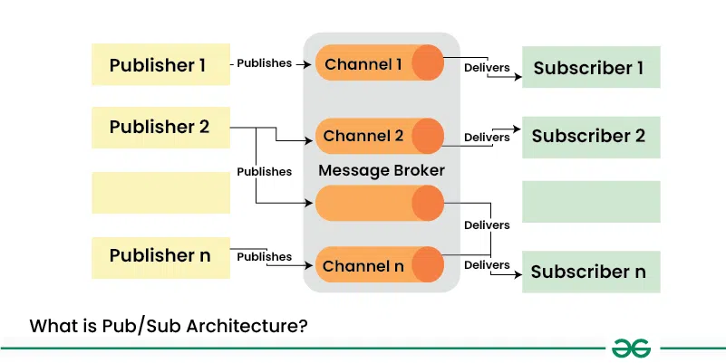
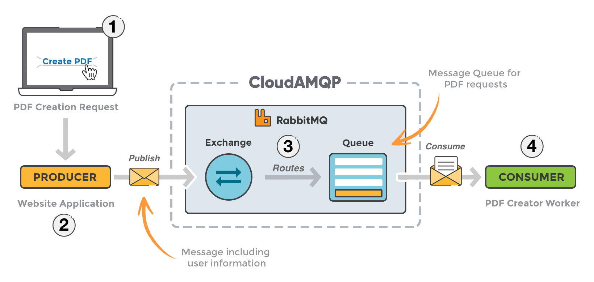

# Patterns map

| **Pattern** | GoF group | Problem it names | Where you have already met it | Python does this for you |
| ------------------------ | ------------ | ----------------------------------------------- | ----------------------------------------------------- | ------------------------------------------------ |
| **Strategy**             | behavioural  | one of several interchangeable algorithms       | `sorted(key=…)`, Django `PASSWORD_HASHERS`            | a function, or `dict[str, Callable]`              |
| **Factory / Registry**   | creational   | pick a class from configuration                 | `create_engine("postgresql+psycopg://…")`             | a function; `__init_subclass__`; entry points     |
| **Adapter**              | structural   | make a foreign interface fit yours              | `requests.adapters.HTTPAdapter`, DBAPI drivers        | a pydantic model with aliases and validators      |
| **Decorator**            | structural   | add behaviour without editing the callee        | `@login_required`, `@transaction.atomic`              | `@` syntax plus `functools.wraps`                 |
| **Proxy**                | structural   | control access to an object                     | `SimpleLazyObject`, Flask's `LocalProxy`, nginx       | `functools.lru_cache` when caching is all you need |
| **Chain of Responsibility** | behavioural | a pipeline that can short-circuit             | Django `MIDDLEWARE`, WSGI, DRF permissions            | a list of closures plus `functools.reduce`        |
| **Observer**             | behavioural  | announce, and let listeners react               | Django signals, `sqlalchemy.event`, Redis pub/sub     | `logging` — it is already this pattern            |
| **Command**              | behavioural  | a call you can store, queue and replay          | Celery `.delay()`, Alembic `upgrade`/`downgrade`      | `functools.partial`, or a frozen dataclass        |
| **Repository / UoW**     | —            | a collection-shaped seam over storage           | SQLAlchemy `Session`, Django `Manager`                | your ORM already is one                           |
| **Template Method**      | behavioural  | fixed algorithm, replaceable steps              | Django CBVs, `TestCase.setUp`, `do_GET`               | composition, when the steps vary independently    |
| **Singleton**            | creational   | exactly one instance                            | Django `settings`, `logging.getLogger`                | the module system; `@lru_cache`                   |
| **Iterator**             | behavioural  | walk a collection lazily                        | every `for` loop                                      | generators and `yield`                            |
| **Visitor**              | behavioural  | one operation per node type                     | `ast.NodeVisitor`                                     | `functools.singledispatch`, `match`/`case`        |
| **Prototype**            | creational   | copy a configured object                        | —                                                     | `copy.deepcopy`, `dataclasses.replace`            |
| **Builder**              | creational   | many optional construction arguments            | `select().where().order_by()`                         | keyword arguments and defaults                    |
| **Abstract Factory**     | creational   | families of related products                    | —                                                     | a function returning a tuple, or a module         |
| **State**                | behavioural  | behaviour changes with an internal mode         | —                                                     | an `Enum` plus `match`, or a dict of callables    |

Most of these rows have no file in this folder. They are here so you know they exist, and know why they
are absent: each one is either solved by a language feature Python already has, or it exists to work
around a limitation Python does not have. The GoF book was written for C++ in 1994.

## Coded in this folder

| File | Pattern | Domain |
| --- | --- | --- |
| `01_singleton.py` | Singleton | application settings |
| `02_template_method.py` | Template Method | nightly export jobs |
| `03_proxy_middleware.py` | Proxy + Chain of Responsibility | an HTTP request pipeline |
| `adapter/` | Adapter | three shipping carrier APIs |
| `05_strategy.py` | Strategy | checkout payment providers |
| `06_observer.py` | Observer | order lifecycle events |

Six patterns, chosen because you will meet all six inside a web framework before you write any of them
yourself: Django's `settings` (Singleton), its class-based views (Template Method), its `MIDDLEWARE`
(Proxy/Chain), its DB backends (Adapter), its `PASSWORD_HASHERS` (Strategy) and its signals (Observer).

## In-process observers versus a broker

`06_observer.py` builds the left-hand side of this picture: publisher and subscribers in one process, one
call stack, one failure domain. If a handler blocks, the publisher blocks. If the process dies between
publishing and handling, the event is gone.

The same pattern across process boundaries. The bus becomes a broker, handlers become worker processes
that may not even be written in Python, and the event now has to be serializable — a `Decimal` amount
that travelled fine through the in-process bus needs a decision at the JSON boundary. Delivery becomes a
real subject: at-most-once, at-least-once, acknowledgements, dead-letter queues. You will stand one of
these up in `module03/`.

## The rule

A pattern is a name for a shape you were going to build anyway. Before you reach for one, say out loud
which future change it makes cheap. If you cannot name the change, you are paying for the indirection and
getting nothing back — `01_singleton.py` is the shortest demonstration of that bill arriving.

SOLID states the goals; patterns are named ways of reaching them. Open/Closed is the goal — Strategy,
Registry and plugin entry points are three means. Dependency Inversion is the goal — constructor
injection, `Protocol` and FastAPI's `Depends` are three means. Learn the goals; the patterns are just
vocabulary for describing which one you used. See [`../09_solid/`](../09_solid/).
