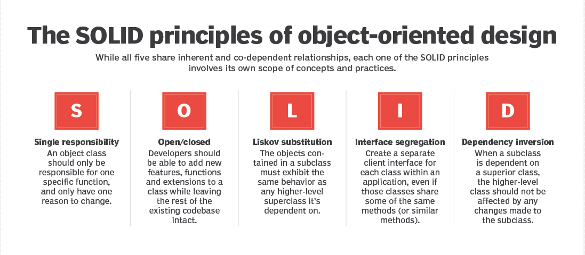

# 09 — SOLID



Five principles, five before/after pairs. Each file is small enough to type live in a lecture:
no comments, no framework, just the shape of the problem and the shape of the fix.

```bash
cd module01/09_solid
poetry env use 3.13
poetry install

poetry run python -m solid_ex.s_single_responsibility.before
poetry run python -m solid_ex.s_single_responsibility.after
poetry run python -m solid_ex.o_open_closed.before
poetry run python -m solid_ex.o_open_closed.after
poetry run python -m solid_ex.l_liskov.before
poetry run python -m solid_ex.l_liskov.after
poetry run python -m solid_ex.i_interface_segregation.before
poetry run python -m solid_ex.i_interface_segregation.after
poetry run python -m solid_ex.d_dependency_inversion.before
poetry run python -m solid_ex.d_dependency_inversion.after

poetry run pytest -v
```

Every `before.py` runs to completion and exits 0 — it demonstrates its failure by catching and
printing it, not by dumping a traceback.

## The five

| | Principle | Domain | The "before" is bad because | What the "after" changes |
| --- | --- | --- | --- | --- |
| **S** | Single Responsibility | order report | one method computes, formats and prints — reusing any part means copying all three | three functions: `order_total`, `render`, `send_to_console` |
| **O** | Open/Closed | discounts | every new customer type edits the same `if/elif` in `final_price` | each discount is a class; a new one is a new class, zero edits |
| **L** | Liskov Substitution | file storage | `ReadOnlyStorage(Storage)` raises from `save()`, so generic `backup()` blows up mid-loop | read-only is the *base*; only `WritableStorage` claims `save()` |
| **I** | Interface Segregation | office printer | `CheapPrinter` must stub `scan()` and `fax()` with `NotImplementedError` | `Printer`, `Scanner`, `Fax` roles; each device claims only what it does |
| **D** | Dependency Inversion | order confirmations | `OrderService` constructs its own `SmtpClient` in `__init__` | the notifier is injected; email, telegram and the test fake are interchangeable |

Note L and I are the same conversation: the subclass that raises is almost always caused by an
interface too wide to implement honestly, and splitting the interface is the cure.

## The tests

| File | What it proves |
| --- | --- |
| `test_o_discounts.py` | A brand-new discount is defined inside the test and works with zero edits to existing code. |
| `test_l_storage.py` | The before replica breaks code written for the base; the after read-only storage never claims `save()`. |
| `test_d_order_service.py` | A four-line `FakeNotifier` asserts the exact confirmation messages — no SMTP anywhere. |

## See also

- [`solid_map.md`](solid_map.md) — each principle in one sentence, the smell that means you broke it,
  and how SOLID relates to the design patterns in [`../08_patterns/`](../08_patterns/).
- [`../solid/`](../solid/) — the previous version of this material, kept for reference.
